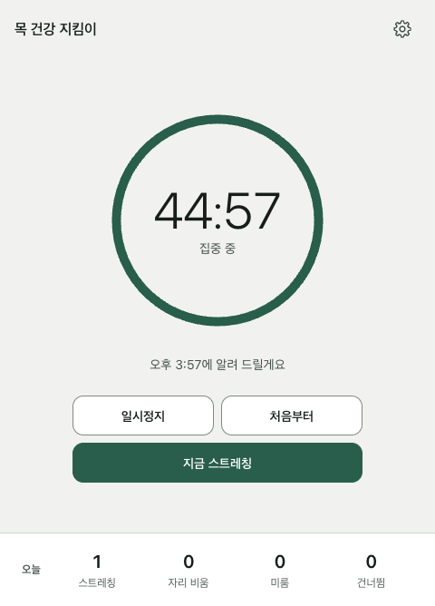
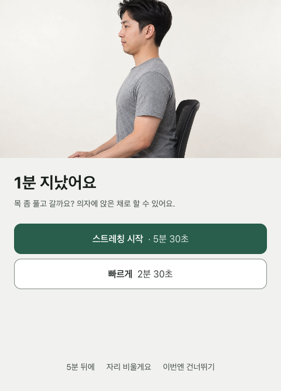
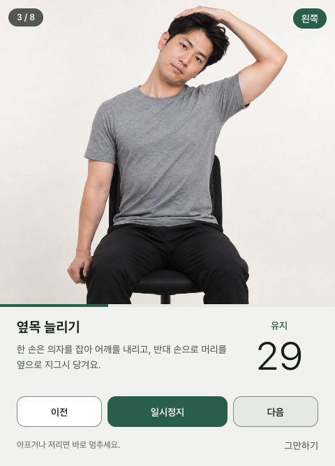
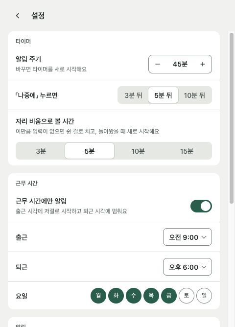

# 목 건강 지킴이 (Protect Neck)

정해진 시간마다 목·어깨 스트레칭을 안내하는 데스크톱 앱입니다. 맥과 윈도우에서 돌아갑니다.

<p>
  
  
  
  
</p>

## 무엇을 하나

- **집중 타이머**: 기본 30분마다 알려 줍니다(15~90분). 창을 닫아도 메뉴 막대·트레이에서 계속 돕니다.
- **출퇴근 시간**: 근무 시간(기본 평일 09:00~18:00)에만 돌고, 출근 시각에 저절로 시작해 퇴근 시각에 멈춥니다.
- **자리 비움 감지**: 5분 넘게 키보드·마우스 입력이 없거나 화면을 잠그면 쉰 것으로 보고, 돌아왔을 때 새로 시작합니다.
- **알림에서 고르기**: 스트레칭(기본 약 5분 30초·빠른 약 2분 30초, 동작마다 최소 30초), 5분 뒤에, 자리 비울게요, 이번엔 건너뛰기.
- **스트레칭 안내**: 실사 사진, 남은 초, 반복 횟수, 좌우 표시. 구간이 바뀔 때 소리가 나서 화면을 안 봐도 따라 할 수 있습니다.
- **오늘 기록**: 스트레칭·자리 비움·미룸·건너뜀 횟수.

기획과 동작 규칙은 [docs/PLANNING.md](docs/PLANNING.md)에 있습니다.

## 실행

Node.js 20 이상이 필요합니다.

```bash
npm install
npm start
```

## 빌드

```bash
npm run dist:mac   # dist/protect-neck-<버전>-mac.dmg (Intel·Apple Silicon 공용)
npm run dist:win   # dist/protect-neck-<버전>-win-setup.exe (x64·arm64)
```

맥에서 윈도우 설치 파일도 만들 수 있습니다. 코드 서명을 하지 않아서 처음 열 때 경고가 뜹니다.

- 맥: 앱을 우클릭해서 「열기」를 누릅니다. 막히면 `xattr -dr com.apple.quarantine "/Applications/ProtectNeck.app"`
- 윈도우: SmartScreen 창에서 「추가 정보」 → 「실행」

## 테스트

```bash
npm test
```

타이머 규칙(알림·미루기·자리 비움·화면 잠금·출퇴근)과 루틴 구성, 설정 저장을 검사합니다.

## 구조

```
src/
├── main/
│   ├── main.js       # 창, 메뉴 막대·트레이, 알림, 자리 비움 감지
│   ├── engine.js     # 타이머 상태 기계 (Electron 없이 테스트)
│   ├── schedule.js   # 출퇴근 시간 판정
│   ├── store.js      # 설정·오늘 기록 (사용자 데이터 폴더의 JSON)
│   └── preload.js
├── renderer/         # 화면 (HTML·CSS·JS, 빌드 과정 없음)
└── shared/
    └── routines.js   # 스트레칭 동작과 루틴
assets/stretch/       # 스트레칭 사진
scripts/gen-images.sh # 사진 생성 스크립트 (codex CLI)
```

## 사진

스트레칭 사진은 AI로 생성했습니다(`scripts/gen-images.sh`). 실제 사람이 아니며, 동작은 일반적인 사무실 스트레칭을 참고했습니다. 아프거나 저리면 바로 멈추고, 목 질환이 있으면 전문가와 상의하세요.

## 라이선스

MIT
